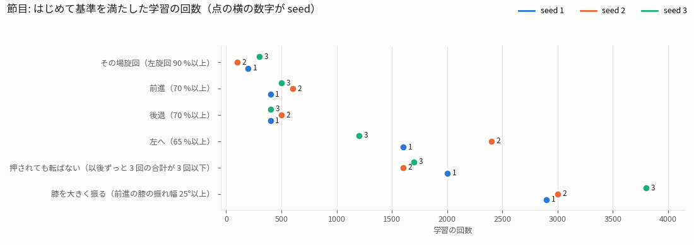
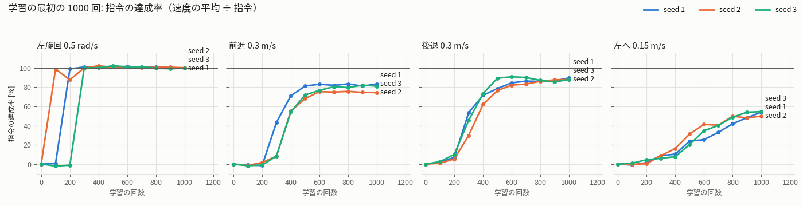
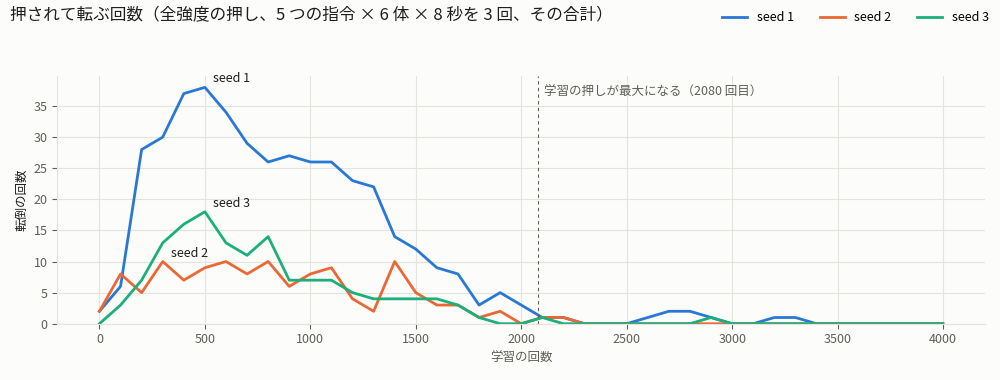
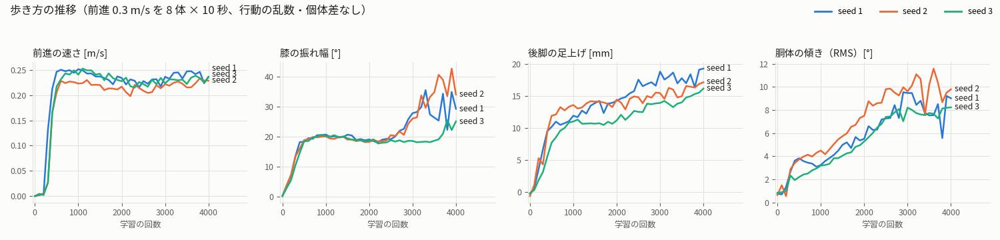

# v31 の 3 seed の比較（2026-10-19）

ユーザーの依頼「seed 1・2・3 の経過の動画を撮り、3 つのデータを比べて違いをまとめる。違いが分かる資料と動画も作る」への回答。
3 本は同じ設定・同じ報酬で、違うのは学習の乱数の種（seed）だけ。だから下の違いはすべて seed によるもの。

使ったデータ（測り方は `README.md`）:

- 指令の達成率: 3 seed × 41 個のチェックポイント（100 回ごと）。5 つの指令 × 6 体、行動の乱数・個体差なし。
- 押しへの強さ: 同じ測定に全強度の押しを入れたもの。**乱数の種を変えて 3 回**測った（`v31_progress_push*_s<seed>.json`）。
- 歩き方: 前進 0.3 m/s を 8 体 × 10 秒。**41 個すべて**で測った（`v31_gait_s<seed>.json`）。
- 完成した方策: 是正後の 128 体・個体差ありの測定（`experiments/results_json/v31_s<seed>_*.json`、`sym_v31_s<seed>.json`）。

## 要点

1. **覚える順番は 3 seed で同じで、時期だけがずれる。** その場旋回 → 前後 → 押しに強くなる → 横歩きと脚の大きな振り、の順。
   ずれは、その場旋回で 100〜300 回目、横歩きで 1200〜2400 回目、脚の大きな振りで 2900〜3800 回目。
2. **いちばん大きな違いは、中盤の押しへの強さ。** 400 回目の転倒は 37・7・16 回（seed 1・2・3）。
   seed 1 は 1300 回目まで弱く、seed 2 は最初から強い。2000〜2300 回目に 3 seed とも 0 になる。
3. **歩き方のくせは、学習の途中から最後まで続く。**
   - seed 2 は前進がいちばん遅く（37 時点のうち 34）、胴体の傾きがいちばん大きい（31 時点のうち 30）。
   - seed 3 は後脚の足上げがいちばん低い（31 時点のうち 31）。
4. **完成した方策の違いは小さい。** 指令の達成率は前進 76〜78 %・後退 86〜91 %・横 67〜72 %・旋回 99〜102 %。
   多くの指標で、seed のばらつきは v23 を 4 seed で学習したばらつき（ノイズ床）以下だった。
5. **1 seed だけで「何回目に何ができるか」を言うと、100〜1200 回ずれる。** 学習の経過を論じるときも 3 seed で確かめる（日誌 §6 の方針と同じ）。

## 動画（git 管理外）

| 動画 | 中身 | 長さ |
|---|---|---|
| `media/videos/quad_progress/v31-s1_progress.mp4` | seed 1 の経過。8 つの時点（0・100・300・400・1000・2000・3000・3999 回目）を同じ指令で | 2 分 42 秒 |
| `media/videos/quad_progress/v31-s2_progress.mp4` | seed 2 の経過（10/13 に実機で歩かせた方策） | 2 分 42 秒 |
| `media/videos/quad_progress/v31-s3_progress.mp4` | seed 3 の経過 | 2 分 42 秒 |
| `media/videos/quad_progress/v31-seeds_compare.mp4` | 3 seed を横に並べ、違いが出る場面を同じ指令・同じ押しで見せる（9 つの場面） | 2 分 37 秒 |

seed ごとの動画は 3 本とも同じ形にした。区切りの画面には 3 seed の数字の表を出し、その動画の seed の行を明るくしている。
説明の数字は、手で書き写さずに測定のファイルから入れている（`Stats.fill`）。
動画の中の横からの押しは 1 回だけの例で、押しへの強さは測定で判断する。
seed 1 は 100・300・400 回目に、seed 2 は 400 回目に、seed 3 は 100・400・1000 回目に転んだ。

比較の動画の場面:

| 場面 | 学習の回数 | 見せ方 | 見えること |
|---|---|---|---|
| ① | 100 | 斜め前から、左旋回 5 秒 | 回れるのは seed 2 だけ |
| ② | 200 | 同じ | seed 1 も回れる。seed 3 はまだ |
| ③ | 300 | 左旋回 3 秒 → 前進 6 秒 | 3 seed とも回れる。前に歩き出したのは seed 1 だけ |
| ④ | 400 | 30 体ずつの群れに全強度の押し | seed 1 がいちばん多く転ぶ（動画では 9・2・2 回） |
| ⑤ | 1000 | 同じ | seed 1 はまだ転ぶ（8・3・4 回） |
| ⑥ | 2000 | 同じ | 3 seed とも転ばない（0・0・0 回） |
| ⑦ | 3200 | 横から、前進（0.5 倍速） | seed 1・2 は膝を大きく振る。seed 3 はまだ |
| ⑧ | 3999 | 斜め前から、経過の動画と同じ指令の列 | 3 seed とも全方向に歩き、押されても転ばない |
| ⑨ | 3999 | 後ろから、前進 | 後脚の幅と胴体の傾きの違い |

群れの場面は、測定と同じく 5 つの指令 × 6 体を 1 seed に並べ、学習の押しと同じ時機（各体の 3 秒ごと）に全強度の押しを入れた。
押しの向きと大きさは乱数だが、3 seed で同じ乱数の列を使う（体の番号ごとに共通）。転んだ所に赤い輪を出し、転んだ体は最初の位置に戻して続ける。
動画の群れは 1 回分の例なので、400 回目の seed 3 は測定（3 回の合計 16 回、1 回あたり 5〜6 回）より少なく 2 回だった。区切りの画面には測定の数字を出している。

## 1. 覚える時期



| 節目（はじめて基準を満たした回数） | seed 1 | seed 2 | seed 3 |
|---|---|---|---|
| その場旋回（左旋回 90 %以上） | 200 回目 | 100 回目 | 300 回目 |
| 前進（70 %以上） | 400 回目 | 600 回目 | 500 回目 |
| 後退（70 %以上） | 400 回目 | 500 回目 | 400 回目 |
| 左へ（65 %以上） | 1600 回目 | 2400 回目 | 1200 回目 |
| 押されても転ばない（以後ずっと 3 回の合計が 3 回以下） | 2000 回目 | 1600 回目 | 1700 回目 |
| 膝を大きく振る（前進の膝の振れ幅 25°以上） | 2900 回目 | 3000 回目 | 3800 回目 |



- **その場旋回**は 3 seed とも最初にできるようになる。100 回のあいだに 0 % → 99〜101 % へ一気に上がる。
- **前後**は 3 seed とも 300〜400 回目に歩き出す。300 回目の前進は 43・8・8 %で、seed 1 だけ 1 段早い。
- **横歩き**はゆっくり伸びる。65 %に届くのは seed 3 が 1200 回目、seed 2 が 2400 回目で、1200 回の開きがある。
- 順番はどの seed でも同じ。違うのは時期だけ。

## 2. 押しへの強さ



全強度の押し（3 秒ごと、向きは乱数、大きさは最大 1.0 m/s の速度のけり）で、30 体 × 8 秒を乱数の種を変えて 3 回測った転倒の合計:

| 学習の回数 | 200 | 400 | 700 | 1000 | 1300 | 1600 | 2000 | 2300 | 3999 |
|---|---|---|---|---|---|---|---|---|---|
| seed 1 | 28 | 37 | 29 | 26 | 22 | 9 | 3 | 0 | 0 |
| seed 2 | 5 | 7 | 8 | 8 | 2 | 3 | 0 | 0 | 0 |
| seed 3 | 7 | 16 | 11 | 7 | 4 | 4 | 0 | 0 | 0 |

- 200〜1300 回目の 12 時点で、seed 1 は 22〜38 回、seed 2 は 2〜10 回、seed 3 は 4〜18 回。どの時点でも seed 1 がいちばん多い。
- 3 回の測定どうしのばらつきは小さい。例えば 400 回目は seed 1 が 14・11・12 回、seed 2 が 2・3・2 回、seed 3 が 6・5・5 回で、順位は 3 回とも同じ。
- 3 seed とも、押しが最大になる 2080 回目（`push_curriculum_steps` 50000 ÷ 24）の前後で 0 近くになる。
  だから「押しに強くなる時期」は学習の押しの強さの計画で決まり、「途中でどれだけ弱いか」が seed で違う。
- **1 回だけの押しでは差がほとんど出ない**（予備の試し、記録用のスクリプトは残していない）。
  - 前進中に 8 方向から 1 回ずつ 1.0 m/s で押すと、400 回目で 8 体中 3・2・3 体、1000 回目で 2・3・1 体が転んだ。
  - 前進だけでも 3 秒ごとに繰り返し押すと差が出た（30 体 × 10 秒 × 3 回で、400 回目に 15・2・16 回）。
  - 経過の動画の固定の押しで seed の差が見えないのはこのため。比較の動画では群れに繰り返し押す場面にした。

## 3. 歩き方のくせ



前進 0.3 m/s（8 体 × 10 秒、行動の乱数・個体差なし）。チェックポイントごとの値は揺れるので、期間の平均で比べる:

| 指標 | 1000〜2900 回目の平均 | 3000〜3999 回目の平均 |
|---|---|---|
| 前進の速さ [m/s] | 0.232・0.215・0.233 | 0.240・0.224・0.231 |
| 膝の振れ幅 [°] | 20.1・19.6・19.0 | 29.3・34.0・20.3 |
| 後脚の足上げ [mm] | 14.5・14.1・11.7 | 18.0・15.9・14.5 |
| 胴体の傾き（RMS）[°] | 5.8・7.3・5.4 | 8.3・9.9・7.9 |
| 歩容の一致 [%] | 87.6・85.5・87.7 | 86.0・88.2・88.6 |
| トルクの平均 [%] | 18.7・18.8・19.5 | 18.5・19.3・18.7 |
| トルクの 99%点 [%] | 56.9・58.1・58.1 | 56.7・57.8・56.2 |

（値は seed 1・2・3 の順。）

- **seed 2 は前進が遅い。** 400〜3999 回目の 37 時点のうち 34 時点でいちばん遅い。指令の達成率でも、前進は 1000 回目以降の 31 時点のうち 27 時点で 3 seed でいちばん低い（3000〜3999 回目の平均 79・73・76 %）。
- **seed 2 は胴体がいちばん傾く**（1000〜3999 回目の 31 時点のうち 30）。傾きは 3 seed とも学習が進むほど大きくなる（1000 回目 3〜5° → 3999 回目 8〜10°）。
- **seed 3 は後脚の足上げがいちばん低い**（31 時点のうち 31）。後退と横歩きの達成率はいちばん高い（3000〜3999 回目の平均で後退 92 %、横 75 %）。止まる指令でのずれもいちばん大きい（1000 回目以降の平均 0.013 m/s、seed 1・2 は 0.007・0.010）。
- **膝を大きく振る変化は、終盤に起きる。** 2600 回目までは 3 seed とも 18〜21°でそろっている。
  そこから seed 1・2 は 2700〜3000 回目にかけて 26〜28°へ、seed 3 は 3700〜3800 回目に 21 → 26°へ上がる。
  seed 2 は最大 43°（3900 回目）まで上がる。環境の側で段階的に変える設定は押しの強さだけで、2080 回目から一定なので、方策の側の変化。
- **seed 1 は終盤の歩容の一致がいちばん低い**（3000〜3999 回目の 11 時点すべて）。差は 2〜3 点。

## 4. 完成した方策（3999 回目）

是正後の測定（128 体・個体差あり・3 反復、日誌 §6.3 と同じデータ）を seed ごとに分けた。

| 方向 | 達成率（seed 1・2・3） | トルクのピーク [%] | 膝の振れ幅 [°] |
|---|---|---|---|
| 前進 0.3 m/s | 78・76・78 % | 94.9・89.9・88.6 | 29.0・33.8・25.2 |
| 後退 0.3 m/s | 86・87・91 % | 82.4・95.7・98.6 | 28.9・37.6・28.6 |
| 左へ 0.15 m/s | 72・72・67 % | 83.2・77.2・82.1 | 31.9・38.6・30.6 |
| 左旋回 0.5 rad/s | 101・101・102 % | 86.3・76.0・78.4 | 42.5・31.1・30.8 |
| 右旋回 0.5 rad/s | 100・101・99 % | 88.0・83.2・90.3 | 45.8・41.1・40.8 |

前進のときの指標を、seed のばらつき（3 本の標準偏差）と v23 のノイズ床（4 seed の標準偏差、`experiments/noise_floor_fixurdf.json`）で比べた:

| 指標（前進） | seed 1・2・3 | v31 の 3 seed の標準偏差 | v23 の 4 seed の標準偏差 |
|---|---|---|---|
| 速さ [m/s] | 0.235・0.229・0.235 | 0.003 | 0.005 |
| 横ずれ [%] | 3.2・2.5・1.6 | 0.8 | 2.2 |
| トルクの平均 [%] | 18.3・18.9・19.5 | 0.64 | 0.27 |
| トルクの 99%点 [%] | 57.8・57.9・58.5 | 0.37 | 0.85 |
| 膝の振れ幅 [°] | 29.0・33.8・25.2 | 4.3 | 5.7 |
| 後脚の足上げ [mm] | 19.6・17.7・16.2 | 1.7 | 1.6 |
| 前脚の足上げ [mm] | 21.2・20.0・17.4 | 1.9 | 1.0 |
| 歩容の一致 [%] | 84.9・87.8・88.4 | 1.9 | 1.1 |
| トルクのピーク [%] | 94.9・89.9・88.6 | 3.3 | 3.8 |
| 接地の左右差 [pt] | 3.8・4.2・4.0 | 0.18 | 0.56 |
| 着地の足裏の傾き [°] | 4.7・4.4・4.1 | 0.30 | 0.50 |
| 向きのずれ（10 秒、絶対値）[°] | 4.7・2.8・2.0 | 1.4 | 3.2 |
| 股関節の左右差 [°] | 0.28・0.90・1.23 | — | — |
| 後脚の左右の間隔 [cm] | 8.0・4.4・6.7 | — | — |

（股関節の左右差と後脚の間隔は `sym_v31_s<seed>.json`、64 体・個体差あり。）

- 両方の値がある 12 指標のうち 8 つで、v31 の seed のばらつきは v23 のノイズ床より小さい。後脚の足上げはほぼ同じ（1.7 と 1.6 mm）。
- トルクの平均・前脚の足上げ・歩容の一致は v23 の約 2 倍。ただし 3 本と 4 本の標準偏差どうしなので、本当に大きいかは言えない。
- 後脚の左右の間隔は seed 2 が 4.4 cm で、ほかの 2 本（6.7〜8.0 cm）より狭い（比較の動画 ⑨ で後ろから見える）。

**実機に seed 2 を選んだ理由についての注記。**
選んだ理由は「全 5 方向でトルクのピークが 95.7 % 以下と最もバランスがよい」（日誌 §7.5）だった。
しかし同じ測定では、seed 1 の 5 方向の最大は 94.9 %（前進）で、95.7 % 以下は seed 1 にも当てはまる。
seed 2 がいちばん低いのは横・左旋回・右旋回の 3 方向。seed 3 は後退で 98.6 % に達する。
ピークは 1 回の瞬間の値でばらつきが大きい（v23 の標準偏差 3.8 点）ので、この差で選び直す理由にはならない。
実機の結果（108 秒で転倒 0）は変わらない。

## 作り方

動画の台本（区切りの画面とまとめの文）は `quad/jobs/v31_progress_videos.sh`（seed ごと）と `quad/jobs/v31_seeds_compare_video.sh`（比較）にある。

```bash
# 押しの測定を乱数の種を変えて繰り返す（種 0 は README の測定）
python quad/khr_quad_progress.py measure -e khr-quadruped31-s1 --push --rng_seed 1 -o experiments/quad_progress/v31_progress_push_r1_s1.json
# 歩き方を 41 個すべてで（測ったものは飛ばす）
python quad/khr_quad_progress.py gait -e khr-quadruped31-s1 -o experiments/quad_progress/v31_gait_s1.json
# 比較の図 4 枚と節目の表
python quad/khr_quad_progress.py seeds -e khr-quadruped31-s1 khr-quadruped31-s2 khr-quadruped31-s3
# seed ごとの経過の動画（区切りの画面に 3 seed の表。説明の {fwd#1} などは測定の数字に置き換わる）
DISPLAY=:1 python quad/khr_quad_progress.py record -e khr-quadruped31-s1 --stats_prefix experiments/quad_progress/v31 \
  --schedule "0.3,0,0:3;push:0,-1.0;0.3,0,0:2;0,0,0.5:2.5;0,0.15,0:2.5;-0.3,0,0:2.5" --card_s 5 \
  --stage 100 "足を動かし始める" "左旋回 {turn#1}/..." ... -o media/videos/quad_progress/v31-s1_progress.mp4
# 比較の動画（1 体ずつの場面と群れの場面は別に作って ffmpeg の concat でつなぐ）
DISPLAY=:1 python quad/khr_quad_progress.py compare -e khr-quadruped31-s1 khr-quadruped31-s2 khr-quadruped31-s3 \
  --stats_prefix experiments/quad_progress/v31 --scene 100 diag "0,0,0.5:5" "<見出し>" "<説明>" ... -o <part>.mp4
DISPLAY=:1 python quad/khr_quad_progress.py compare -e ... --crowd --first 4 --scene 400 crowd "" "<見出し>" "<説明>" ... -o <part>.mp4
```

1 体ずつの場面は 3 体を 1 つの環境に入れ、描画だけ 12 m ずつずらして（視線に直角、床の模様がそろう 2 m の倍数）別々のカメラで写す。
reset は決まった姿勢に戻すだけなので、1 体だけで動かしたときと同じ動きになる。
